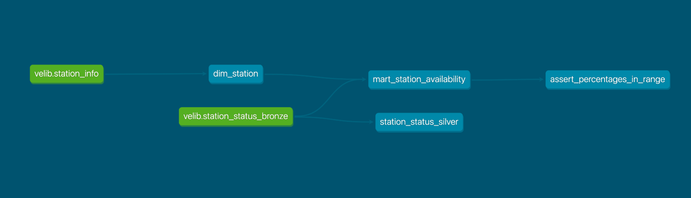
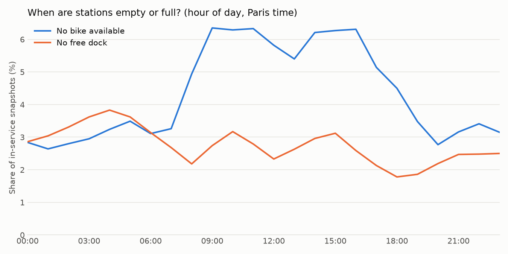
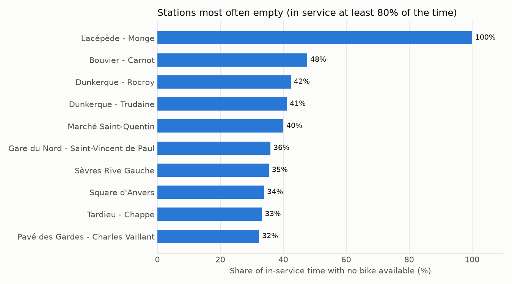

# Paris Mobility Pipeline

A real-time data pipeline for Paris Vélib' bike-share availability: streaming ingestion with Kafka and Spark Structured Streaming into an Apache Iceberg lakehouse, batch transformations and data-quality tests in dbt, and scheduling and table maintenance orchestrated by Apache Airflow.

## Architecture

```
Vélib' GBFS API (station_status, every ~60 s)
        │  producer.py (Python)
        ▼
Kafka topic: velib.status.raw (3 partitions, keyed by station_id)
        │  Spark Structured Streaming (1-minute micro-batches, checkpointed)
        ▼
┌──────────────────────── Iceberg lakehouse ────────────────────────┐
│                                                                    │
│  bronze: station_status_bronze          station_info (reference)   │
│       │                                       │                    │
│       │  dbt (SQL executed by Spark via Thrift)                    │
│       ├──► silver: station_status_silver      ▼                    │
│       │                                  dim_station               │
│       └──────────► gold: mart_station_availability ◄──┘            │
└────────────────────────────────────────────────────────────────────┘
        ▲
        │  Apache Airflow
        ├── every 15 min : dbt run → dbt test
        └── hourly       : Iceberg compaction + snapshot expiration
```

## Tech stack

| Layer | Technology |
|---|---|
| Ingestion | Python, `requests`, `confluent-kafka` |
| Message broker | Apache Kafka 3.9 (KRaft mode) |
| Stream processing | Spark 3.5 Structured Streaming |
| Storage | Apache Iceberg (REST catalog, S3-compatible object store) |
| Transformation & tests | dbt (dbt-spark, Thrift connection) |
| Orchestration | Apache Airflow 3.3 |
| Infrastructure | Docker Compose |

## Data model

| Layer | Table | Grain | Built by |
|---|---|---|---|
| Bronze | `station_status_bronze` | One row per station per snapshot (~1 min) | Spark Structured Streaming |
| Reference | `station_info` | One row per station | `ingest_station_info.py` (batch) |
| Silver | `station_status_silver` | One row per station state change | dbt |
| Dimension | `dim_station` | One row per station | dbt |
| Gold | `mart_station_availability` | One row per station | dbt |

See [`docs/data_dictionary.md`](docs/data_dictionary.md) for field definitions and [`docs/design_decisions.md`](docs/design_decisions.md) for the reasoning behind each choice.

## Key findings

### 1. `last_reported` is not a reliable deduplication key
Station bike counts sometimes changed while `last_reported` stayed the same, so deduplicating on `(station_id, last_reported)` would silently drop real state changes. Silver deduplicates by **content** instead: a row is kept only when bikes, docks, or renting/returning status differ from the previous snapshot.

### 2. Most raw rows are duplicates
| Window | Bronze rows | Silver rows | Removed |
|---|---|---|---|
| ~3 hours, daytime | 41,040 | 7,947 | 80.6% |
| ~18 hours, incl. night | 1,673,520 | 124,973 | 92.5% |

The higher ratio over the longer window is consistent with quiet overnight periods, when station states barely change.

### 3. Ranking by "empty" time alone is misleading
Stations out of service are excluded (`is_renting = 1`), but some stations operate only part of the day. In the unfiltered ranking, **6 of the top 10 "most often empty" stations were in service less than 25% of the time**. The gold table therefore exposes `coverage_pct`, and a coverage filter (≥ 80%) surfaces stations that are consistently empty.

### 4. Fault tolerance
The streaming job was stopped for about an hour and its container was recreated. After restart, it resumed from the persisted checkpoint: **0 duplicates across 4M rows**, and every snapshot produced during the downtime was recovered from Kafka. A later full Docker restart gave the same result (0 duplicates across 6.3M rows). A separate 51-minute gap was traced to the producer side (the host machine sleeping): Kafka can only buffer data that reaches it.

### 5. Small files and memory pressure
One-minute streaming micro-batches produced **11,925 data files averaging ~10 KB** over a few days. Reading them repeatedly crashed the Spark Thrift Server with out-of-memory errors, which in turn failed the scheduled dbt runs. Three changes fixed it:

- **Compaction**: Iceberg's `rewrite_data_files` merged the 11,925 files into a single 118 MB file, and an hourly job now compacts new files.
- **Snapshot expiration**: an hourly job removes old table versions, so metadata stays small.
- **Resource limits**: the Thrift Server was capped at 4 cores and 2 GB (instead of all 14 cores sharing ~1 GB), and Docker's memory was raised from 7.75 GB to 16 GB.

A full dbt refresh (build + 9 tests) went from **~6 minutes, then failing**, to **~11 seconds**.

### 6. Maintenance jobs can fail too
The first `expire_snapshots` run had to process thousands of accumulated snapshots and crashed halfway: old versions were removed from the metadata, but their data files were not deleted, leaving orphan files in storage. The table itself stayed consistent, because Iceberg commits metadata changes separately from file deletion. Later runs use `stream_results => true` and run hourly, so each run only handles a small batch.

## Orchestration

| DAG | Schedule | Tasks |
|---|---|---|
| `velib_dbt_refresh` | Every 15 minutes | `dbt run` → `dbt test` |
| `velib_iceberg_maintenance` | Hourly, at minute 7 | Compact bronze, expire old snapshots on all tables |

The maintenance job runs at minute 7 so that it does not overlap with a dbt refresh. Both DAGs run dbt inside the Airflow container, which reaches Spark through the Docker network (`spark-iceberg:10000`).

## Data quality

9 dbt tests run on every refresh:

- `not_null` / `unique` on primary keys of `dim_station` and `mart_station_availability`
- `not_null` on key columns of `station_status_silver`
- A custom test asserting that all percentage metrics stay within 0–100

## Repository structure

```
├── producer/            # Kafka producer polling the Vélib' API
├── spark/               # Streaming and batch Spark jobs
├── dbt/                 # dbt project: sources, models, tests, maintenance macro
├── airflow/             # Airflow image (with dbt) and DAGs
├── docker/              # Custom entrypoint for the Spark container
├── docs/                # Data dictionary and design decisions
├── docker-compose.yml   # Spark, Iceberg REST catalog, object store, Kafka, Kafka UI, Airflow
└── requirements.txt
```

## How to run

```bash
# 1. Start the infrastructure (Docker needs ~16 GB of memory)
docker compose up -d --build

# 2. Python environment
python -m venv .venv
source .venv/bin/activate
python -m pip install -r requirements.txt

# 3. Start the producer (keep running)
python producer/producer.py

# 4. Start the streaming job (keep running, in another terminal)
docker exec -it spark-iceberg spark-submit \
  --packages org.apache.spark:spark-sql-kafka-0-10_2.12:3.5.5 \
  /home/iceberg/jobs/stream_to_bronze.py

# 5. Load station reference data
docker exec -it spark-iceberg spark-submit /home/iceberg/jobs/ingest_station_info.py

# 6. Prepare the catalog for dbt
docker exec spark-iceberg spark-sql -e "CREATE NAMESPACE IF NOT EXISTS demo.default;"

# 7. Enable both DAGs in the Airflow UI: http://localhost:8081
```

dbt can also be run manually from the host: `cd dbt && dbt run && dbt test`.

Kafka UI is available at http://localhost:8090.

## Roadmap

- [x] Streaming ingestion: API → Kafka → Spark → Iceberg bronze
- [x] dbt models: silver, dimension, gold
- [x] dbt tests, including a custom range check
- [x] Persisted streaming checkpoint and fault-tolerance test
- [x] Scheduled dbt runs with Airflow
- [x] Automated Iceberg maintenance (compaction, snapshot expiration)
- [x] Persist object storage on the host
- [x] Visualisation of the results

## Limitations

- Runs on a single machine: when the host sleeps, the producer stops and no data reaches Kafka.
- The observation window is a few days, so station rankings are indicative rather than conclusive.
- Each producer cycle takes slightly more than 60 seconds, so an hour occasionally contains 59 snapshots instead of 60.
- Orphan-file cleanup (`remove_orphan_files`) needs a Hadoop S3 filesystem, which this setup does not configure, so the orphan files left by the interrupted maintenance run (~120 MB) remain in storage.
- The Iceberg REST catalog used here is a test fixture; some metadata-table queries (e.g. `table.files`, `table.snapshots`) are not supported.

## Results

### Data lineage



Gold metrics are computed from minute-level bronze rather than from silver, because silver keeps only state changes and would bias time-based averages.

### When are stations empty or full?



Stations run out of bikes during the day (peaking around 09:00 and 15:00) and fill up overnight (peaking around 04:00), consistent with commuting flows. The sample covers only a few days, including a weekend and a public holiday, so this is an early observation.

### Stations most often empty



Only stations in service at least 80% of the time are ranked. Lacépède - Monge never had a bike available while reported as in service, which points to a station or data issue rather than demand.